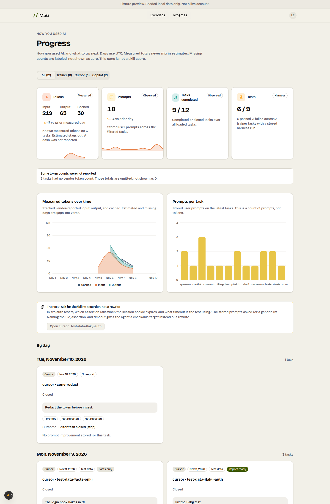
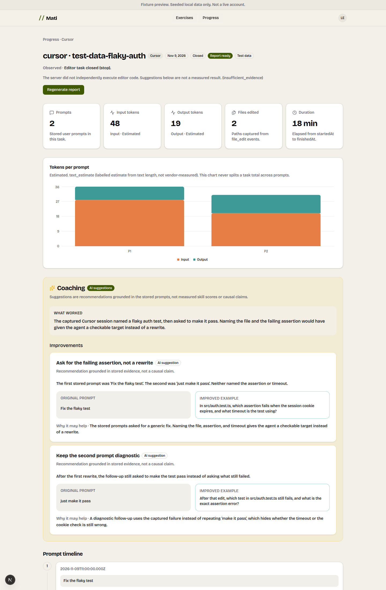

<p align="center">
  <picture>
    <source media="(prefers-color-scheme: dark)" srcset="docs/brand/mati-wordmark-dark.svg">
    
  </picture>
</p>

<p align="center"><strong>Learn from how you use AI on coding tasks.</strong></p>

Mati captures the prompts you send in Cursor or Copilot, then turns each closed task into a learning report on your Progress page. Reports stay grounded in stored prompts, responses, edited file names, and labelled token counts. Coaching is an AI suggestion, not a skill score.

Open-source. Individual. Browser JavaScript exercises plus editor capture. This is not a Google interview replica and does not claim feature parity with any other product.

Product code lives in `apps/app`. Editor capture lives in [`extensions/mati`](extensions/mati/README.md). Design notes: [`docs/mati-mvp.md`](docs/mati-mvp.md), [`docs/extension-design.md`](docs/extension-design.md). The rest of this monorepo is a next-forge workspace template.

Mati auth is **Supabase Auth**. Mati data is **Supabase PostgreSQL** accessed at runtime through **Prisma 7** with per-request RLS. Do not use Clerk, Neon, Cursor-hosted Postgres, or `packages/database` for Mati. There is no `@bodha/*` or `@mati/*` workspace scope; product packages stay `@repo/*`.

## How it works

1. **Capture.** After one-time workspace consent, the editor extension records Agent / Copilot Chat prompts on this device. Capture stays anonymous in the editor. Cursor hooks have no vendor token counts; any number is a labelled `text_estimate` and undercounts. Copilot Chat can report vendor-measured tokens from OpenTelemetry chat spans when Mati is allowed to write a file exporter.
2. **Link.** **Mati: Open report** opens a short device preview. Sign in (existing email auth; no anonymous sign-in) and confirm **Link this device to your account**. A short-lived claim code is used; the long-lived device secret is never placed in a URL. Past and future tasks from that device then appear under the account.
3. **Per-task report.** Each closed capture task gets a dashboard: prompt count, labelled input/output tokens, files edited, duration when known, a token chart, prompt timeline, responses, edited files, and coaching (what worked, concrete improvements, original vs improved prompt). Generate or regenerate with your saved BYOK key. With no key, the report is facts-only plus a Settings CTA.
4. **Progress.** Signed-in Progress lists task cards (source, date, prompt count, token figures with estimate/measured, status, report-ready or facts-only) and a day-by-day view across trainer and claimed editor devices.

Trainer exercises still exist: two manually maintained browser-JavaScript challenges (shelf, cache) with Monaco and `public/harness.js`. There is no Node, Python, or ML execution sandbox.

## Screenshots

Progress list (task cards and day-by-day) and a Cursor capture task with coaching. Seeded test data.

<p align="center">
  
</p>

<p align="center">
  
</p>

## Quickstart

pnpm workspaces (`packageManager`: `pnpm@10.33.4`). Install from the **repository root**.

```bash
pnpm install --frozen-lockfile
cp apps/app/.env.example apps/app/.env.local
pnpm --filter app prisma:generate
pnpm --filter app dev
```

Apply Prisma migrations against an isolated non-production project (`pnpm --filter app prisma:migrate:deploy`, `DIRECT_URL` on port 5432). Do not `prisma db push`. Local stack: `pnpm dlx supabase start` (uses `supabase/config.toml`; `project_id` remains `bodha-dev` so existing volumes keep working), then `prisma migrate deploy`.

Copy `apps/app/.env.example`. Never commit real values. Names are `MATI_*` only; `BODHA_*` is not read. Encode reserved password characters (`p@ss` → `p%40ss`). Preview and production must use **separate** Supabase projects, pooler URLs, and encryption keys.

| Variable | Required | Where | Role |
| --- | --- | --- | --- |
| `NEXT_PUBLIC_SUPABASE_URL` | yes | browser | Public project URL |
| `NEXT_PUBLIC_SUPABASE_PUBLISHABLE_KEY` | yes | browser | Public anon/publishable key |
| `DATABASE_URL` | yes (runtime) | server | Transaction-mode pooler `:6543` |
| `DIRECT_URL` | CLI migrate/db pull | server | Session-mode pooler `:5432` |
| `MATI_CREDENTIALS_ENCRYPTION_KEY` | to store BYOK | server | 32-byte key (`openssl rand -hex 32`); distinct per environment |
| `MATI_OPERATOR_LLM_PROVIDER` | no | server | Optional operator default (`openai`, `anthropic`, `sarvam`, `xai`, `google`) |
| `MATI_OPERATOR_LLM_MODEL` | no | server | Optional operator default model id |
| `MATI_OPERATOR_LLM_API_KEY` | no | server | Optional operator default key |
| `MATI_PROGRESS_TIMEZONE` | no | server | Day-bucket timezone (default `UTC`) |

```bash
pnpm --filter app test
pnpm --filter app typecheck
pnpm --filter app build
pnpm --filter app lint:mati
```

`lint:mati` is the product lint. Root `pnpm check` is **not** a Mati-clean signal; unused next-forge packages report thousands of findings.

## Editor extension

The VS Code-compatible extension in [`extensions/mati`](extensions/mati/README.md) captures Cursor Agent and Copilot Chat after explicit workspace consent. It is not published to the Marketplace or Open VSX yet.

```bash
pnpm --filter mati package
```

Install the `.vsix` with **Extensions: Install from VSIX**. Point `mati.serverUrl` at `http://127.0.0.1:3000` while developing the app locally. After consent, capture re-arms on reload of an unpaused workspace. **Mati: Open report** shows a device preview until you sign in and link the device.

## Privacy

- Workspace consent is explicit and one-time per workspace. Pause persists until you resume. **Mati: Delete my capture data** removes hooks, the device token, and this workspace's consent.
- File contents are not uploaded; edited **paths** can be.
- Known secret patterns are replaced with `[redacted:class]` on the device before upload. That is not a guarantee.
- Token totals are omitted when missing, never shown as zero. Estimates are labelled `text_estimate` and are not mixed into vendor-measured charts.
- Coaching is stored as AI suggestions grounded in captured prompts. It is not a measured skill score or a causal claim.
- Each account only sees its own devices and tasks (RLS). Trainer sessions are not deleted by editor claim/delete commands.

## What this MVP does not do

Corporate/team/manager views, org dashboards, employee comparisons, billing, analytics, AI-generated exercises, a CMS, autonomous agent actions, extra integrations, and Marketplace/Open VSX publish from this repo.

## Architecture

- **Auth:** Supabase Auth (cookie session). Server routes verify identity with `auth.getUser()`, not decode-only JWT claims.
- **Database:** Supabase PostgreSQL. Versioned Prisma migrations in `apps/app/prisma/migrations/` are the **authoritative schema, roles, RLS, policies, grants, and SQL functions**. Apply with `prisma migrate deploy`. Do not `prisma db push`.
- **Runtime queries:** Prisma 7.4.2 + `@prisma/adapter-pg` on `DATABASE_URL` (transaction-mode pooler, port **6543**, `pgbouncer=true`). Each product operation runs in a short transaction that `SET LOCAL ROLE authenticated|anon` and sets `request.jwt.claims` / `request.jwt.claim.sub` from the verified user, then fails closed if role/bypass-RLS checks fail.
- **Models:** Five fixed providers (OpenAI, Anthropic, Sarvam AI, xAI Grok, Google Gemini) via Mastra's model router. Learners pick provider + model and paste a key. No user-supplied base URL.

Cursor **Build Live Apps** is not used. Production, custom domains, and package publish need Amit's explicit approval.

## License

Copyright 2026 AmitMirgal. Licensed under the Apache License, Version 2.0. See `LICENSE.md`.

This repository started from [next-forge](https://github.com/vercel/next-forge) (MIT, Copyright (c) 2025 Vercel). That template's MIT notice still applies to the unmodified next-forge material. Third-party and vendored code keeps its own license.
